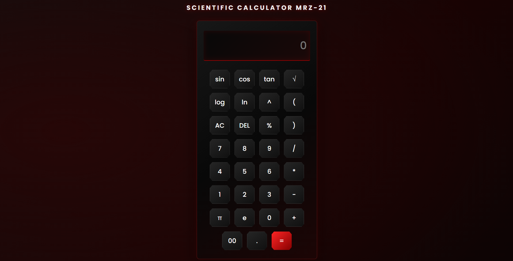

# Scientific Calculator

A scientific calculator I made using HTML, CSS and JavaScript.

I wanted to build something a little more interesting than a basic calculator, so I decided to make a scientific one. I also wanted it to look good, not just work, which is why I went with a dark design.

It can handle normal calculations along with scientific ones like sin, cos, tan, logarithms, square roots and powers. It also supports brackets and includes mathematical constants like π and e.

The trigonometric functions work in degrees by default, so you can directly enter an angle and calculate its value.

The best part is that you do not need to install anything to use it. Just open it in your browser and you're good to go.



*The calculator's dark red interface.*

---

## How you use the calculator

Using it is pretty simple. Open `index.html` in your browser and the calculator is ready.

You can perform calculations by clicking the buttons on the calculator. Enter your expression, press `=` to calculate the answer, use `AC` to clear the display, or `DEL` to remove the last entered character.

Here's a quick look at what it can do:

| You press / enter | What happens |
| ------------------ | ---------------------------------------- |
| `0-9` | Enters numbers |
| `+`, `-`, `*`, `/` | Performs basic calculations |
| `sin(30)` | Calculates the sine of an angle in degrees |
| `cos(60)` | Calculates the cosine of an angle in degrees |
| `tan(45)` | Calculates the tangent of an angle in degrees |
| `log(100)` | Calculates logarithm (base 10) |
| `ln(e)` | Calculates natural logarithm |
| `√(16)` | Calculates the square root |
| `2^3` | Calculates powers |
| `π`, `e` | Uses mathematical constants |
| `(5+3)*2` | Calculates expressions using brackets |
| `AC` | Clears the display |
| `DEL` | Removes the last entered character |
| `=` | Calculates the result |

---

## The design of this calculator

I wanted the calculator to have a slightly different look from the usual ones we see everywhere.

The interface uses a dark theme with soft red, glowing indicators for different buttons.

I took some inspiration from physical scientific calculators like the Casio fx-82MS, but wanted to give mine a bit different and digital look.

---

## How this calculator works

The calculator is made using HTML, CSS and JavaScript.

1. HTML creates the structure of the calculator, including the display and all the buttons.
2. CSS handles the design, colours, shadows, spacing and button effects.
3. JavaScript does the actual calculations and makes the buttons functional.
4. Whenever you click a button, JavaScript updates the expression on the display.
5. When you press `=`, the expression is processed and the result is displayed.
6. For trigonometric functions, the calculator converts radians into degrees internally and round-off it before calculating the result.

The calculations are handled using JavaScript's built-in mathematical functions.

---

## Files in this repository

| File | What it's for |
| ------------ | ------------------------------------------------------------------------------ |
| `index.html` | Contains the main structure, display and calculator buttons |
| `style.css` | Handles the design, dark theme, shadows and button styling |
| `script.js` | Handles calculations and scientific functions |
| `screenshot.png` | Picture of the calculator's interface |


I kept the HTML, CSS and JavaScript in separate files to make things easier to manage and modify and also because I've learned that doing this is a good practice.

---

## Setting it up

There's not much to set up here. You do not need any special software, libraries or build tools.

All you need is a browser.

**1.** Clone the repository:

```bash
git clone https://github.com/morrhez/scientific-calculator.git
```

**2.** Open the downloaded folder.

**3.** Find `index.html` and open it in your browser.

That's it! Your calculator should be ready to use.

---

## Things worth knowing about this

**No installation required.** The entire project runs in your browser. There is no need to install any additional libraries.

**Degree-based trigonometry.** Functions like sin, cos and tan calculate angles in degrees by default.

**Button-based input.** All calculations are performed using the calculator's on-screen buttons.

**Works offline.** Once you've downloaded the project, you can use it without an internet connection.

---

## Why I made this

I made this project mainly to practise my HTML, CSS and JavaScript skills.

While making it, I got to practise working with JavaScript functions, handling user input, updating the interface and connecting everything together.

It's not the most advanced scientific calculator, but it was really a fun project to build and helped me learn quite a bit along the way.

---

## Author

Created by Mohammad Faraz Idreesi ([@morrhez](https://github.com/morrhez)).

If you use or build on this project, I'd love to hear about it!

---

*Made with HTML, CSS, JavaScript, and a lot of trial and error.*
